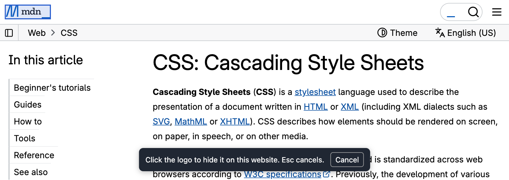
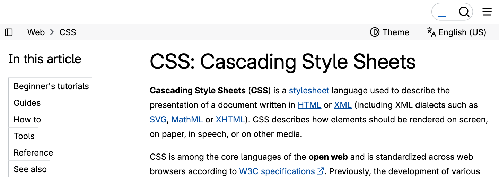
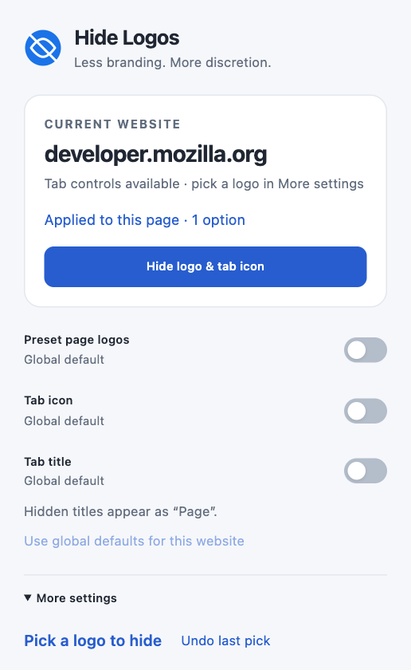

# Hide Logos Extension: Per-Site Privacy & Distraction Control

> A lightweight Chrome Extension that gives users full control over hiding website logos and tab favicons on a per-site basis.


English · [简体中文](README.zh-CN.md)

## 📖 Overview

**Hide Logos** is a browser extension that lets you selectively hide website logos and browser tab favicons, with optional tab title masking. Nothing is hidden by default — you decide which sites to clean up, either individually or via global defaults.

Whether you're working in a public space, sharing your screen, or simply want a cleaner browsing experience, this extension provides granular, per-site control through a clean popup interface.

## ✨ Key Features

*   **🎯 Per-Site Control**: Independently toggle preset logo, tab icon and tab title hiding for each website you visit.
*   **🖱️ Custom Logo Picker (v3.1.0)** — Click a logo to remember it for this website. You can save several picks and undo them one at a time.
*   **🌐 Global Defaults**: Set baseline preferences that apply to all sites without custom overrides.
*   **🔕 Off by Default**: No sites are affected until you explicitly enable hiding — zero surprises.
*   **🚫 Generic Logo Detection**: Optionally match common logo patterns in headers and navigation.
*   **⚡ Real-Time Updates**: Changes apply instantly without requiring a page reload.
*   **🔒 Privacy-First Design**: Logo matching runs in the browser. The extension has no analytics or external rule downloads.
*   **💾 Persistent Settings**: Preferences and picked selectors use Chrome’s sync storage and may sync with your browser account.
*   **🌏 English and Simplified Chinese** — The interface follows your browser’s language, with English as the fallback.

## 🛠 Supported Platforms

The extension includes **optimized CSS rules** for the following sites:

*   **YouTube** — Hides topbar logo
*   **Google Search** — Hides doodles and main logo
*   **X (formerly Twitter)** — Hides home X/bird logo
*   **Gmail** — Hides header logo
*   **Reddit** — Hides modern and classic home logos, plus branding on supported sign-in, verification and network-block pages

Additionally, a **generic ruleset** matches common logo markers in headers and navigation when **Preset page logos** and **Generic logo rules** are both on. On other sites, you can also pick a specific logo yourself.

## 🚀 Installation (Developer Mode)

You can install the extension manually in Chromium 109 or later. No build step is required.

1.  **Clone or Download** the release you want. Extract the extension ZIP from **Assets**, or clone the repository and check out the corresponding release tag. [GitHub Releases](https://github.com/touka2014/hide-logos-extension/releases)
    ```bash
    git clone https://github.com/touka2014/hide-logos-extension.git
    ```
2.  Open your browser and navigate to the Extensions management page:
    *   Chrome: `chrome://extensions/`
    *   Edge: `edge://extensions/`
3.  Enable **Developer mode** (toggle in the top-right corner).
4.  Click **Load unpacked**.
5.  Select the cloned/downloaded directory containing `manifest.json`, then refresh your website tabs.

**Updating from v3.0.0** — Replace the files in the same folder you originally loaded, click **Reload** on the extension card, and refresh your tabs to keep your settings.

## 📖 Usage

1.  Navigate to the website you want to configure.
2.  Click the extension icon in the browser toolbar. The popup shows the current site's hostname.
3.  Click **Hide logo & tab icon** to enable both, or toggle the **per-site** switches individually.
    *   **Preset page logos** — Hides logos matched by the site's built-in rules.
    *   **Tab icon** — Replaces the current site's favicon with a transparent pixel.
    *   **Tab title** — Shows `Page` or `页面` until you switch it off.
4.  Under **More settings**, optionally configure **Global defaults** to set the baseline behavior for all sites.
5.  Click **Use global defaults for this website** to remove per-site overrides and fall back to the global settings.

> **Note:** Per-site settings always take priority over global defaults. Resetting the switches preserves your manual picks.

### Pick a logo to hide (v3.1.0)

1.  Under **More settings**, choose **Pick a logo to hide**. Move the pointer over the logo and click when the outline surrounds it. **Esc** or **Cancel** exits without saving.
2.  Refresh or revisit the site. Matching logos are hidden automatically for that hostname, independently of the three switches above.
3.  Choose **More settings → Undo last pick** to remove the most recent selection for this site. Repeat to undo earlier picks. If a redesign changes the logo, pick it again.

On the English MDN CSS page, the wordmark disappears on the next visit and the navigation stays in place.

| Picking the wordmark | After reloading the page |
| --- | --- |
|  |  |

<details>
<summary>Show the popup and undo button</summary>



</details>

## 📂 Project Structure

```text
.
├── manifest.json       # Manifest V3 configuration
├── content.js          # Applies settings and reports page status
├── popup.html          # Extension popup UI (per-site + global controls)
├── popup.js            # Popup logic and per-site state management
├── popup.css           # Popup styles
├── shared/             # Site matching and per-site settings
├── controllers/        # Logo picker, favicon and tab title masking
├── _locales/           # English and Simplified Chinese messages
├── styles/             # CSS rules for hiding logos
│   ├── youtube.css     # YouTube-specific rules
│   ├── google.css      # Google Search-specific rules
│   ├── gmail.css       # Gmail-specific rules
│   ├── x.css           # X/Twitter-specific rules
│   ├── reddit.css      # Reddit-specific rules
│   ├── picker.css      # Selection outline and picker controls
│   └── generic.css     # Generic rules for any website
├── icons/              # Extension icons
├── docs/screenshots/   # Screenshots for each README language
├── tests/              # Unit and Chromium browser tests
├── README.zh-CN.md     # Simplified Chinese documentation
├── LICENSE             # MIT License
└── README.md           # Documentation
```

## 🔧 Technical Details

*   **Manifest V3**: Requires only the `storage` and `activeTab` permissions. Content scripts run on HTTP(S) pages.
*   **Per-Site Storage**: Each site override and picked selector has its own key in `chrome.storage.sync`. Existing `siteSettings[hostname]` preferences remain readable. A leading `www.` is ignored, while other subdomains have separate settings.
*   **Performance**: CSS hides matching elements, including logos added after navigation. Settings load asynchronously, so a logo can briefly appear on first render.
*   **Error Handling**: The popup shows save failures and flags tabs that need a refresh. The picker works in the main document. Embedded frames and shadow trees may be out of reach.

## 🤝 Contributing

Contributions are welcome! If you find a bug or want to add support for a new website:

1.  Fork the repository.
2.  Create a feature branch (`git checkout -b feature/AmazingFeature`).
3.  Commit your changes (`git commit -m 'feat: Add support for Facebook'`).
4.  Push to the branch (`git push origin feature/AmazingFeature`).
5.  Open a Pull Request.

To run the tests locally, use a Node.js version supported by `package.json`.

```bash
npm ci
npm test
npx playwright install chromium
npm run test:browser
```

## 📄 License

Distributed under the MIT License. See [LICENSE](LICENSE) for more information.

The article text in the cropped MDN screenshots is by Mozilla Contributors and is reproduced under CC BY-SA 2.5. The captures show the extension outlining and hiding the wordmark. [CSS: Cascading Style Sheets](https://developer.mozilla.org/en-US/docs/Web/CSS) · [CC BY-SA 2.5](https://creativecommons.org/licenses/by-sa/2.5/)
