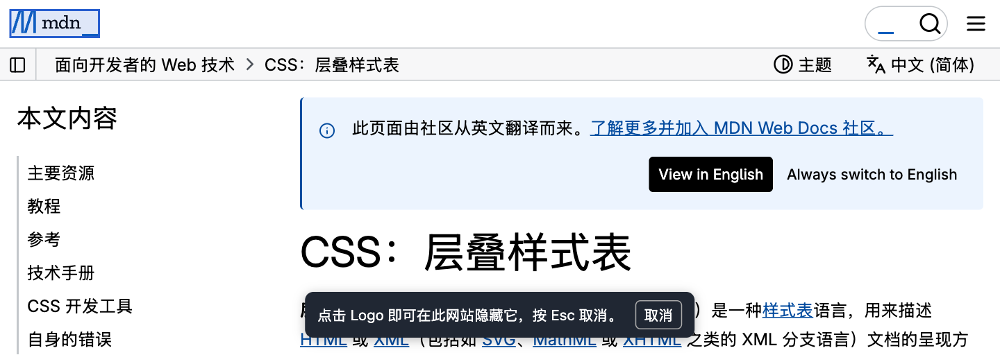
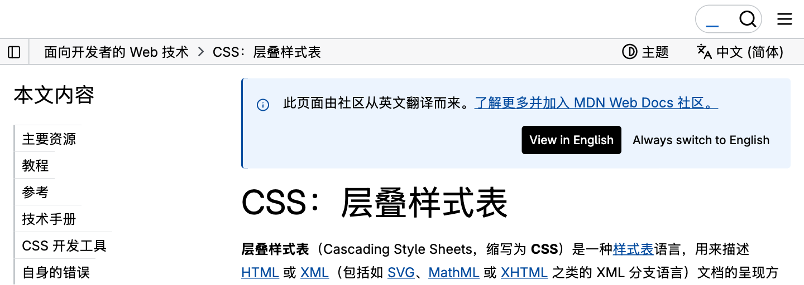
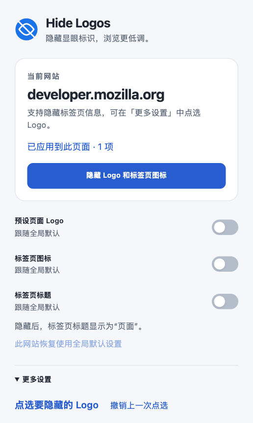

# Hide Logos 扩展：按网站保护隐私，减少浏览干扰

> 一款轻量的 Chrome 扩展，让你决定在哪些网站隐藏页面 Logo 和标签页图标。


[English](README.md) · 简体中文

## 📖 项目简介

**Hide Logos** 可以按网站隐藏页面 Logo、标签页图标，也可以单独隐藏标签页标题。首次安装时，所有隐藏选项都关闭。你可以为每个网站单独设置，也可以使用全局默认设置。

无论是在公共场所工作、与同事共享屏幕，还是希望浏览时少一些干扰，都可以直接在扩展弹窗里选择要隐藏的标识。

## ✨ 主要功能

*   **🎯 按网站设置** — 分别控制当前网站的预设 Logo、标签页图标和标题。
*   **🖱️ 自定义点选 Logo（v3.1.0）** — 在网页上点选一次，扩展就会记住这个网站的选择。可保存多个 Logo，也可逐个撤销。
*   **🌐 全局默认设置** — 为尚未单独配置的网站设定默认行为。
*   **🔕 默认关闭** — 由你决定在哪些网站开启隐藏。
*   **🚫 通用 Logo 识别** — 可选用通用规则，匹配页眉和导航中的常见 Logo。
*   **⚡ 实时更新** — 调整设置后，已打开的标签页也会随之更新。
*   **🔒 隐私保护** — Logo 匹配在浏览器内完成。扩展没有分析统计或远程规则下载。
*   **💾 设置持久保存** — 偏好和点选规则保存到 Chrome 同步存储，可随浏览器账号同步。
*   **🌏 中英文界面** — 跟随浏览器界面语言显示简体中文或英文，其他语言回退到英文。

## 🛠 已适配的网站

扩展为以下网站提供了**专用 CSS 规则**：

*   **YouTube** — 隐藏顶栏 Logo。
*   **Google 搜索** — 隐藏 Doodle 和主 Logo。
*   **X（原 Twitter）** — 隐藏首页链接上的 X 或小鸟标识。
*   **Gmail** — 隐藏页眉 Logo。
*   **Reddit** — 隐藏新版和经典版的首页 Logo，以及已适配的登录、验证和访问受限页标识。

同时开启**预设页面 Logo** 和**通用 Logo 规则**，可以匹配页眉和导航中的常见标识。遇到其他网站，也可以直接点选想隐藏的 Logo。

## 🚀 安装（开发者模式）

支持 Chromium 109 及以上版本，可直接加载，无需编译。

1.  **克隆或下载**所需版本。可以从 Release 的 **Assets** 下载扩展 ZIP 并解压，也可以克隆仓库后切换到对应版本的标签。[GitHub Releases](https://github.com/touka2014/hide-logos-extension/releases)

    ```bash
    git clone https://github.com/touka2014/hide-logos-extension.git
    ```

2.  打开浏览器的扩展管理页。
    *   Chrome 使用 `chrome://extensions/`。
    *   Edge 使用 `edge://extensions/`。
3.  开启**开发者模式**。
4.  点击**加载已解压的扩展程序**。
5.  选择直接包含 `manifest.json` 的目录，然后刷新要使用扩展的网页。

**从 v3.0.0 更新**时，将新版文件覆盖到原先加载的文件夹，在扩展卡片上点击**重新加载**，然后刷新网页即可沿用设置。

## 📖 使用方法

1.  打开要设置的网站。
2.  点击浏览器工具栏中的扩展图标。弹窗会显示当前网站的主机名。
3.  点击**隐藏 Logo 和标签页图标**可同时开启这两项，也可以分别调整当前网站的开关。
    *   **预设页面 Logo** — 隐藏与内置站点规则匹配的 Logo。
    *   **标签页图标** — 用透明像素替换当前网站的图标。
    *   **标签页标题** — 显示「页面」或「Page」，关闭后恢复网站标题。
4.  在**更多设置**中调整**全局默认设置**，供其他网站沿用。
5.  点击**此网站恢复使用全局默认设置**，可重置此网站单独设置的开关。

> **提示**　网站单独设置的开关优先于全局默认设置。重置开关后，手动点选的规则仍会保留。

### 点选要隐藏的 Logo（v3.1.0）

1.  打开**更多设置 → 点选要隐藏的 Logo**。把指针移到 Logo 上，确认边框圈住目标后点击。按 **Esc** 或点击**取消**可放弃本次点选。
2.  刷新或再次访问同一网站，匹配的 Logo 会自动隐藏。点选规则按主机名保存，与上面的三个开关独立生效。
3.  打开**更多设置 → 撤销上一次点选**，移除当前网站最近保存的一条规则。继续点击可依次撤销更早的选择。如果网站改版后 Logo 再次出现，可以重新点选。

下面以 MDN 中文 CSS 页面为例。再次访问时，左上角的字标已隐藏，导航仍在原位。

| 点选时，边框圈住字标 | 刷新后，字标自动隐藏 |
| --- | --- |
|  |  |

<details>
<summary>查看扩展弹窗和撤销按钮</summary>



</details>

## 📂 项目结构

```text
.
├── manifest.json       # Manifest V3 配置
├── content.js          # 应用设置并反馈页面状态
├── popup.html          # 扩展弹窗（站点及全局控制）
├── popup.js            # 弹窗交互与站点状态管理
├── popup.css           # 弹窗样式
├── shared/             # 域名匹配与站点设置
├── controllers/        # Logo 点选、标签页图标和标题的隐藏与恢复
├── _locales/           # 英文与简体中文文案
├── styles/             # 隐藏 Logo 的 CSS 规则
│   ├── youtube.css     # YouTube 专用规则
│   ├── google.css      # Google 搜索专用规则
│   ├── gmail.css       # Gmail 专用规则
│   ├── x.css           # X / Twitter 专用规则
│   ├── reddit.css      # Reddit 专用规则
│   ├── picker.css      # 点选边框和操作提示
│   └── generic.css     # 通用 Logo 规则
├── icons/              # 扩展图标
├── docs/screenshots/   # 中英文 README 展示截图
├── tests/              # 单元测试和 Chromium 浏览器测试
├── README.zh-CN.md     # 中文文档
├── LICENSE             # MIT 许可证
└── README.md           # 英文文档
```

## 🔧 技术细节

*   **Manifest V3** — 仅申请 `storage` 和 `activeTab` 权限，内容脚本在 HTTP(S) 网页上运行。
*   **按站点存储** — 每个单站开关和点选规则都在 `chrome.storage.sync` 中单独保存，同时兼容旧版的 `siteSettings[hostname]`。开头的 `www.` 会被忽略，其他子域名单独设置。
*   **性能** — CSS 也会作用于页面重新渲染时加入的 Logo。初次打开页面需要异步读取设置，Logo 可能短暂出现。
*   **错误处理** — 弹窗会提示保存失败或网页需要刷新。点选作用于主文档，嵌入框架或 Shadow DOM 中的 Logo 可能无法选中。

## 🤝 参与贡献

欢迎反馈问题，也欢迎为更多网站补充规则。提交改动的步骤如下。

1.  Fork 本仓库。
2.  创建功能分支（`git checkout -b feature/AmazingFeature`）。
3.  提交改动（`git commit -m 'feat: Add support for Facebook'`）。
4.  推送功能分支（`git push origin feature/AmazingFeature`）。
5.  发起 Pull Request。

使用 `package.json` 支持的 Node.js 版本，在本地运行测试。

```bash
npm ci
npm test
npx playwright install chromium
npm run test:browser
```

## 📄 许可证

本项目使用 MIT 许可证。详见 [LICENSE](LICENSE)。

MDN 截图中的文章文字由 Mozilla Contributors 创作，按 CC BY-SA 2.5 许可转载。截图展示了扩展圈选和隐藏字标时的页面区域。[CSS：层叠样式表](https://developer.mozilla.org/zh-CN/docs/Web/CSS) · [CC BY-SA 2.5](https://creativecommons.org/licenses/by-sa/2.5/)
